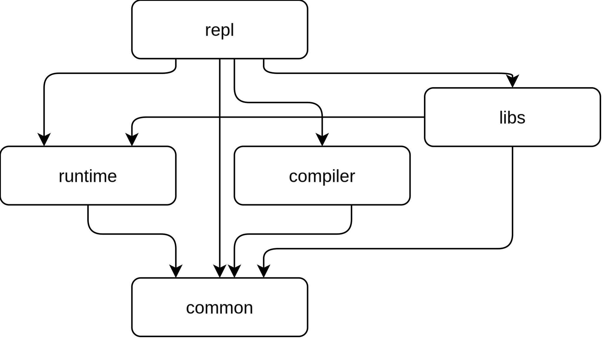
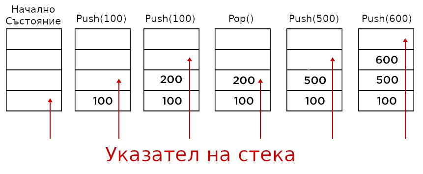
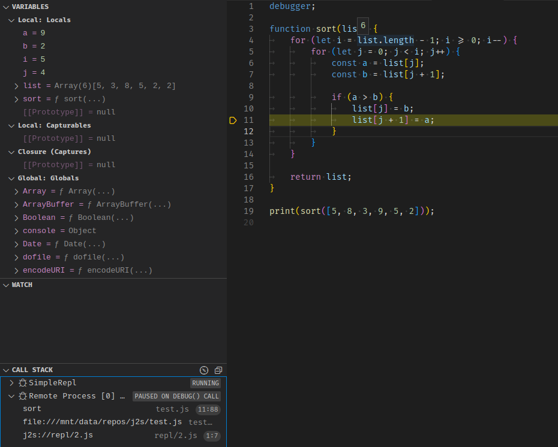

# Увод {.nonum}

Един от най-важните принципи на програмирането е този на разширимостта. Този принцип повелява, че софтуерът трябва да изграждан по начин, по който може неговата функционалност да бъде разширена без вече написаният софтуер да бъде променян. Това е добре известен проблем в сферата на софтуерното инженерство, като едно от най-ефективните решения е интегрирането на втори помощен език, чрез който потребителя да може да разширява функционалността на оригиналният продукт.

Но защо разширимостта е толкова важна? Това се дължи на факта, че често потребителите на софтуерните продукти искат да разширят функционалността на продукта. Традиционно, разширяването може да стане само като потребителя се свърже с разработчика на продукта и да помоли за добавянето на функционалността. Това обаче е не само непрактично, но и води до прекомерно нарастване на софтуера, което го прави сложен за поддръжка и използване.

Въвеждането на скриптови езици като помощни механизми за разширяване на функционалността предлага значително по-ефективно решение. Езиците като Python, Lua и JavaScript могат да бъдат използвани за добавяне на нова функционалност, без да се променя основният код на приложението, като по този начин се осигурява гъвкавост на софтуерния продукт. JavaScript, в частност, е един от най-широко използваните езици в съвременната разработка, поради своята популярност, която се дължи на употребата на езика в уеб технологиите.

Целта на тази дипломна работа е да създаде лесно вградим, малък на размер интерпретатор на „EcmaScript 5.1“ езика (по-добре познат като JavaScript, както ще се и нарича оттук нататък) за продукти, написани на езикът „Java“.

# Проучвателна част

## Съществуващи JavaScript интерпретатори

### V8

V8 [@refs-v8] е интерпретатора за JavaScript на Google, написан на C++. Той е най-широко разпространената среда за изпълнение на JavaScript код. Създаден е, за да служи на Chromium браузърът (на който е базиран Google Chrome, който има близо 70% пазарен дял [@refs-market-share]). Освен това V8 се използва и от много среди за разработка на сървърен код, най-популярните от които са „NodeJS“ [@refs-nodejs] и „Deno“ [@refs-deno]. Поради своята популярност, имплементацията на JavaScript от V8 е „де факто“ стандарта за езика, заради което по времето на разработката на този проекто, NodeJS, базиран на V8, беше използван за сферяване на резултатите от този проект. Архитектурно, V8 използва „JIT“ (Just-in-Time) технологията за компилиране, която обаче не е засегната тук.

- **Предимства**
  - Бързодействие
  - Добра поддръжка от Google
  - Популярен, следователно добра поддръжка от обществото
- **Недостатъци:**
  - Голям размер на крайният изпълним код
  - Сложно вграждане в проекти, които не са написани на C++

### JavaScriptCore

JavaScriptCore [@refs-jsc] е интерпретатора за JavaScript на Apple, написан на C++. Не е толкова разпространен, колкото V8, но въпреки това намира употреба в браузъра на Apple „Safari“, както и алтернативната на NodeJS среда за изпълнение „Bun“. Въпреки че не е толкова разпространен, JavaScriptCore е компетентен интерпретатор, като по много параметри се доближава и даже превъзхожда V8. Интерпретатора, подобно на V8, използва „Just-in-Time“ технологията за компилиране.

- **Предимства:**
  - Бързодействие
  - Добра поддръжка от Apple
- **Недостатъци:**
  - Голям размер на крайният изпълним код
  - Сложно вграждане в проекти, които не са написани на C++

----

### Nashorn

Rhino [@refs-rhino], създаден през 1997 г. от Netscape като част от тогавашните им усилията да пренапишат „Navigator“ на Java, е един от първите интерпретатори за JavaScript, написани на Java [@refs-rhino-history]. Първоначално интерпретатора е компилирал JavaScript кода към Java байт-код, но поради редица проблеми е въведен нов режим на интерпретирано изпълнение. След като усилията на Netscape да пренапишат браузъра си на Java приключват, Rhino остава като JavaScript интерпретатор, който се използва от много проекти. За голям период от време, Rhino остава де факто стандартния JavaScript интерпретатор за Java.

- **Предимства**
  - Малък размер
  - Лесно вградим в проекти
- **Недостатъци:**
  - Не се поддържа толкова активно
  - Лоша производителност
  - Непълно покритие на EcmaScript 5.1

----

### Rhino

Nashorn [@refs-nashorn] е първият официален JavaScript интерпретатор на Oracle, вграден във виртуалната машина на Java от версия 8. Той е по-бърз от неговият предходник Rhino, понеже Nashorn отново компилира JavaScript кода към Java байт-код. От 15та версия на Java виртуалната версия включително, Oracle премахва Nashorn от виртуалната машина, като проекта бива прехвърлен на Mozilla.

- **Предимства**
  - Малък размер
  - Лесно вградим в проекти
  - Пълно покритие на EcmaScript 5.1
  - Задоволително бързодействие
- **Недостатъци:**
  - Не се поддържа толкова активно

### GraalJS

GraalJS [@refs-graaljs] е най-новият JavaScript интерпретатор на Oracle, написан на Java. Той е базиран на Truffle [@refs-truffle], среда за „полиглотно“ изпълнение на код - прави възможно изпълнението на няколко езика в една среда едновременно. Освен че GraalJS използва средата Truffle, която компилира кода до ефективен Java байт-код, ако се използва алтернативната виртуална машина на Oracle GraalVM, може да бъде постигната производителност, съпоставима с V8. Въпреки че производителността, която GraalJS демонстрира е впечатляваща, проекта е с изключително голям размер, което означава, че ако даден проект има GraalJS като зависимост, размерите на изпълнимите файлове на проекта ще се умножат неколкократно.

- **Предимства**
  - Бързодействие
  - Добра поддръжка от Oracle
- **Недостатъци:**
  - Голям размер на крайният изпълним код
  - Сложен и негъвкав публичен интерфейс

### QuickJS

QuickJS [@refs-quickjs] е интерпретатор на JavaScript. Той споделя основната философията на този проект - да може да се вгражда лесно в други проекти, както и да бъде малък на размер. По производителност интерпретатора е около 2 - 3 пъти по-бавен от V8 в режим без компилация [@refs-quickjs-benchmark]. Проекта се разработва и поддържа от един човек - Фабрис Белърд, който освен този проект, поддържа и други проекти като FFMpeg, QEMU и TCC.

- **Предимства**
  - Малък размер
  - Задоволително бързодействие
  - Лесно вграждане в проекти
- **Недостатъци:**
  - Сложно вграждане в проекти, които не са написани на C/C++

----

## Стандарти и документация за JavaScript

### Стандарт ECMA 262 (версия 5.1)

Това е стандартът [@refs-ecma-262], който документира езикът JavaScript. Въпреки че има по-нови версии на този стандарт, този проект имплементира само тази версия на стандарта (по-нататък ще бъде уточнено защо). Стандарта се съблюдава и развива от TC39 комитета на ECMA [@refs-tc39]. Стандартът съдържа информация за всички свойства на JavaScript:

- Синтаксис
- Семантики
- Стандартни библиотеки
- DOM библиотеки
- Допълнения, които уточняват поддръжката на по-старите версии на стандарта

Този стандарт е основата, върху която този проект е създаден, понеже е източника на истина, който всеки интерпретатор трябва да спазва.

### MDN Уеб документация

MDN Уеб документацията [@refs-mdn] е документация, създадена от общността, с подобна на Уикипедия философия - всеки може да прави приноси към документацията. Тази документация е един от най-ценните и широко използвани източници на информация както за JavaScript, така и за всичко останало, свързано с уеб технологиите. Въпреки че тази документация не е създадена от ECMA, тя напълно задоволително обобщава ECMA 262 стандарта, заради което този ресурс беше използван често като заместител на ECMA 262 стандарта.

## Методи за изпълнение на код

За да се изпълни код е нужно той първо да бъде разчетен и превърнат във форма, четима за интерпретатора. В тази дипломна работа обаче не е засегнато разчитането на код (може да видите повече за приложения примерен компилатор в [@допълнение]).

### Директно разчитане на код

При този метод на изпълнение на код интерпретатора директно разчита и изпълнява описаните от кода действия. Това е най-неефективният метод за изпълнение на код, понеже всеки път когато дадена операция се изпълнява се налага тя да бъде разчетена наново, което може да бъде скъпа операция. Този метод се използва рядко в практиката, най-вече за „Shell“ езици и някой по-стари интерпретирани езици като „Basic“.

### Компилиране до изпълним файл

При този метод се създава програма, наречена „компилатор“ [@refs-compilers], която разчита кода и го превежда към изпълним за средата файл. Едва тогава изпълнимият файл може да бъде изпълнен, като той ще извърши същите действия и алгоритми, които са описани във входния код. Този метод традиционно се ползва за системни езици, но има проекти, които прилагат този метод и за традиционно скриптови езици.

### Хибриден - компилиране до междинен език

При тази архитектура се създава междинен език [@refs-il], който е по-лесен за разчитане. Не е задължително този език да има текстово представяне и най-често е асемблероподобен. След това се създават два основни компонента - компилатора, който превръща кода към този междинен език и интерпретатора, който разчита и изпълнява междинния език. Повечето модерни интерпретатори използват тази архитектура, като някой езици отделят компилатора като отделна програма, която разработчика трябва да изпълни, за да създаде изпълним код за „виртуалната машина“ на междинният език. На този принцип работят езиците „Java“ (компилиран до Java байт-код) и „C#“ (компилиран до CIL).

:::{.figure}

```cs
.assembly Hello {}
.assembly extern mscorlib {}
.method static void Main()
{
	.entrypoint
	.maxstack 1
	ldstr "Hello, world!"
	call void [mscorlib]System.Console::WriteLine(string)
	ret
}
```

Примерен CIL код, компилиран от C#
:::

### Компилация в реално време - JiT

Компилацията в реално време [@refs-jit] е разширение на хибридните интерпретатори, при които междинният език, когато интерпретатора прецени, се превежда към изпълним за процесора код. При компилацията на междинния език могат да бъдат използвани редица методи за оптимизация, като:

- Оптимизиране на дадени пътища на изпълнение за сметка на други
- Правене на предположения за стойностите, с които кода ще работи
- Статистически анализ на пътищата на изпълнение и стойностите, с които кода работи
- Размотаване на циклите (loop unrolling)
- Вграждане на функция (function inlining)

Някои по-модерни интерпретатори (като V8 и OpenJDK) използват компилация в реално време, обаче този проект ще използва само хибридния модел за интерпретиране.

# Архитектура и избор на развойна среда

## Концепция на интерпретатора на JavaScript

Основната концепция на този проект е да направи възможно изпълнението на JavaScript код под Java, като особена важност се придава на възможността за лесно вграждане на интерпретатора в съществуващ проект. За целта, следните основни изисквания трябва да бъдат покрити от интерпретатора, подредени по важност от най-важни до по-маловажни:

- Пълно покритие на семантиките на Ecma 262 5.1 стандарта
- Удобен API за употреба от програмисти
- Да няма зависимости от други библиотеки (за по-лесно вграждане и по-малък размер на компилираната библиотеката)
- Възможност за лесно вграждане в съществуващ Java проект
- Възможност за лесна съвместна работа на Java и JavaScript
- Достатъчно добра производителност (не е фокус на проекта, но все пак е добра идея проектът да има добра производителност)
- Добра изолация на JavaScript кода от Java кода (за сигурност)
- Поддръжка на по-старите версии на Java (за да може да бъде използван проекта навсякъде)

## Избор на инструменти за разработка на проекта

### Език за разработка - Java

Java [@refs-java] е обектно-ориентиран език от високо ниво с автоматично управление на паметта (чрез т. нар. „Garbage Collector“). Езикът се компилира към байт-код и има типова проверка по време на компилацията. Компилираният байт-код не е изпълним от процесор, а се изпълнява чрез виртуалната машина на Java (JVM), което позволява на всеки софтуер, написан на Java да може да бъде изпълнен на всяка машина, за която съществува Java виртуална машина. Силната типизация на Java пък прави някои типове грешки по-сложни.

Езикът има обширна стандартна библиотека и богат набор от разработени от обществото библиотеки. За този проект обаче няма да бъдат използвани тези библиотеки

::: {.figure}

```java
public class Program {
	public static boolean isSorted(int[] arr) {
		if (arr.length < 2) return true;

		int last = arr[0];

		for (int i = 1; i < arr.length; i++) {
			int curr = arr[i];

			if (last > curr) return false;
			last = curr;
		}

		return true;
	}
	public static void main(String[] args) {
		int[] a = new int[] { 1, 2, 3, 4 };
		int[] b = new int[] { 1, 5, 3, 4 };
		System.out.println(isSorted(a)); // true
		System.out.println(isSorted(b)); // false
	}
}
```

Примерен код на Java
:::

### Система за компилация - Gradle

За Java съществуват две системи за компилация на проекти - Maven и Gradle. Поради лични предпочитания и възможността на Gradle да компилира и други езици (нужна за [@допълнение]), Gradle беше избран. Gradle [@refs-gradle] е една от най-използваните системи за компилация в екосистемата на Java. Основната концепция на Gradle е, че конфигурацията на проектите става чрез код, а по-конкретно - Kotlin DSL и Groovy DSL. Groovy обаче е остаряла технология [@refs-groovy-old] и няма проверки на типовете по време на компилацията, заради което разработчиците на Gradle и обществото от Java разработчици препоръчват употребата на Kotlin DSL. Заради това този проект ще бъде използван Kotlin DSL.

::: {.figure}

```c++
plugins {
    kotlin("jvm") version "1.9.0";
    application;
}

group = "com.example";
version = "1.0-SNAPSHOT";

repositories {
    mavenCentral();
}

dependencies {
    implementation(kotlin("stdlib"));
    testImplementation(kotlin("test"));
    testImplementation("junit:junit:4.13.2");
}

application {
    mainClass.set("com.example.MainKt");
}

tasks {
    test {
        useJUnit();
    }
}
```

Примерна конфигурация на Gradle проект чрез Kotlin DSL
:::

----

## Избор на метод за интерпретиране

От разгледаните в [@методи-за-изпълнение-на-код] типове интерпретатори в този проект ще бъде имплементиран хибриден интерпретатор. Като обобщение, хибридният интерпретатор не изпълнява директно програмния език, а компилира езика към междинен език, който след това бива изпълнен. Тази архитектура беше избрана, защото:

- Изпълнението на кода е по-бързо, на цената на нуждата от компилация на кода преди изпълнението му
- Възможността на замяна на компилатора с по-ефективен без промяна на изпълнителя на код

За да бъде използвана тази архитектура обаче трябва да бъде създаден междинен език. За този проект беше създаден асемблероподобен език (описан по-подробно в [@междинен-език-и-неговото-изпълнение]), който да бъде интерпретиран. Решението да е асемблероподобен език е мотивирано от факта, че алгоритъма за изпълнение на поредица от инструкции е прост и ефективен - цикъл с таблица от повиквания за всяка инструкция, както и от факта, че компилацията към асемблероподобен език е сравнително лесно.

# Реализация на интерпретатора

Архитектурата на интерпретатора се състои от няколко основни компонента:

- Управление на средата на изпълнение - т. нар. „Environment“
- Имплементация на операциите с JavaScript стойностите
- Междинният език и неговият изпълнител
- Събитиен цикъл (event loop)
- Система за съхраняване и предоставяне на данни за отстраняване на грешки

## Компоненти на проекта

Проекта се дели на няколко основни части:

- common - Общи класове
- runtime - Интерпретатор
- compilation - Компилатор (описан в [@допълнение])
- libs - Стандартни библиотеки (описан в [@допълнение])
- repl - Команден ред (описан в [@допълнение])

Предимството на тази архитектура е, че интерпретатора и компилатора са отделни - интерпретатора не знае какъв език интерпретира, докато компилатора работи независимо от интерпретатора. От това следва, че компилатора може да бъде заменен с по-добър такъв, или компилатор на различен език, но интерпретатора ще продължава да работи.

Стандартната библиотека и командния ред са за удобството на потребителите и програмистите, които ще използват проекта.



## Средата на изпълнение

Това е най-простият, но и най-важният механизъм на интерпретатора. Той позволява персонализацията на средата на изпълнение на JavaScript кода, както и изолацията на две JavaScript среди на изпълнение. Средата на изпълнение на практика е регистър от добре познати флагови Java обекти, срещу които могат да стоят произволни стойности. Не се използват низове като идентификаторите на тези стойности, понеже може да има конфликти с ключовете - една библиотека може да използва ключа „test“ за референция към тестовите инструменти, докато потребителя може да използва същия ключ за експериментални цели.

Средата за изпълнение може да бъде и наследявана от друга, като новата среда на изпълнение може да скрива ключове на родителя си, да променя стойностите срещу ключове на родителя си без да променя самите стойности в родителя си и да добавя собствени независими ключове. Тази система за наследяване е вдъхновена от системата за прототипи на JavaScript ([@обекти]).

Тази структура от данни се използва в интерпретатора за съхранение и взимане на следните данни:

- Стека на извикванията (`Frame.KEY`)
- Максимална дълбочина на стека на извикванията (`Frame.MAX_STACK_COUNT`)
- Флаг, скриващ стека на извикванията на дадена среда от общия стек на извиквания в диагностичните съобщения (`Frame.HIDE_STACK`)
- Прототипите на елементарните стойности (`Value.BOOL_PROTO`, `Value.NUMBER_PROTO`, ...)
- Прототипите на обектите, масивите и грешките (`Value.OBJECT_PROTO`, `Value.ARRAY_PROTO`, ...)
- Глобалния обект (`Value.GLOBAL`)
- Таблицата на присъщите стойности (`Value.INTRINSICS`)
- Данните за диагностика (`DebugHandler.KEY`)
- Флаг, скриващ кода в тази среда от отстранителя на грешки (`DebugHandler.IGNORE`)
- Референция към събитийния цикъл, отговорен за тази среда на изпълнение (`EventLoop.KEY`)
- Референция към настоящия компилатор (`Compiler.KEY`)

----

### Интерфейс за диагностика

За разработката на едно приложение е изключително важно интерпретатора да има възможността да предоставя данни и интерфейс за диагностика. В нормалното действие на интерпретатора, в средата за изпълнение не присъства подобна система, но разработчика може да реши, в замяна на производителност, да въведе система за диагностика.

В този интерпретатор `DebugHandler` е интерфейса, който се използва като интерфейс за диагностика. Той съдържа методи, който се повикват при дадени събития (фиг. [@debug-event-methods]), както и метода `getMap`, чрез който всички останали потребители на дадената среда могат да вземат „картата“ на дадена функция (т.е., хранилище на съответстващите местоположения на кода на всяка инструкция).

Този интерфейс позволява имплементацията на традиционен дебъгер, който може да бъде използван в традиционни среди за разработка (коментира се примерна имплементация в [@допълнение]). Имплементациите на `DebugHandler` могат да бъде свързана с дадена среда за изпълнение чрез ключа `DebugHandler.KEY`.

:::{.figure id=debug-event-methods}
Име на метода    | Описание
-----------------|---
`onSourceLoad`   | Извиква се от компилатора след компилацията с оригиналния код, които е бил компилиран
`onFunctionLoad` | Извиква се при компилирането на дадена функция с тялото на функцията и картата на тялото
`onInstruction`  | Извиква се от интерпретатора веднага след изпълнението на дадена функция
`onFramePush`    | Извиква се от интерпретатора, когато даден кадър се добавя към стека на извикванията
`onFramePop`     | Извиква се от интерпретатора, когато даден кадър се премахва от стека на извикванията

Методи, съответстващи на събития в интерпретатора
:::

----

## Имплементация на JavaScript стойностите

За JavaScript интерпретатора е нужно да бъде създадена система за управление на JavaScript стойности. Тази система ще бъде използвана както от JavaScript кода, така и от потребителски код, за да се създават и управляват JavaScript стойности според Ecma стандарта.

### Структура на Java класовете

{}

В този проект всички JavaScript стойности имплементират един основен интерфейс - „Value“. Този интерфейс съдържа методи, които съответстват на всяка операция, която може да бъде извършена с JavaScript стойност ([@value-methods-table]). Двата подтипа на „Value“ са интерфейса „PrimitiveValue“ и класа „ObjectValue“. „PrimitiveValue“ е интерфейса, който всички типове за елементарни стойности наслеждават. „ObjectValue“ пък е основният клас за всички типове за стойности-обекти. „ObjectValue“ има два основни подкласа - „ArrayLikeValue“, основен клас на всички класове за обектите, които се държат като масиви и „FunctionValue“, основният клас на всички класове за JavaScript функциите.

### Празни стойности

Празните стойности са `null` и `undefined`. Тези стойности, както и в други езици, се използват за отбелязването на липса на стойност. JavaScript предоставя две празни стойности, защото `undefined`, преди въвеждането на `in` оператора, е бил единственият начин да се разбере дали член на даден обект съществува или не. Тези стойности имат следните общи свойства:

- Когато се направи опит да се достъпи техен член се хвърля грешка
- Не са истинни (превръщат се към булевата стойност `false`)
- Превръщат се към специалната числова стойност `NaN`
- Нямат прототип и при опит той да бъде взет или зададен се хвърля грешка

За стойността `undefined` е специално заделен типовия низ (низа, върнат при операцията `typeof` върху стойността) „undefined“ докато `null` споделя „object“ с останалите обекти.

В кода и двете стойности са имплементирани с класа `VoidValue`, който може да бъде използван за да бъдат създадени и други празни стойности.

----

### Елементарни стойности

В JavaScript елементарните стойности са всички стойности, които не са обекти. Такива стойности не могат да съдържат референция към друга JavaScript стойност. Такива стойности биват:

- Празни стойности (null и undefined)
- Булеви стойности (true и false)
- Числови стойности (по стандарт 64-битови числа с плаваща запетая)
- Низове (по стандарт съставени от 16-битови символи)
- Символи (маркерни стойности, обяснени по-надолу)

Всички елементарни стойности (освен празните стойности) имат константен прототип в зависимост от типа си, но нямат собствени членове (изключение прави низа, който симулира структурата на константен масив от символи).

### Символи

Символите са особен тим от елементарни стойности в JavaScript, въведен в по-късните разработки на Ecma. Понеже обаче символите се използват от голяма част от модерният JavaScript код, беше взето решение те да бъдат имплементирани в интерпретатора въпреки това.

Символите са флагови стойности, които потребителя може да създаде сам. Отличаващото ги свойство е, че при всяко създаване на символ се създава уникален символ, т.е. не може по-късно да бъде създаден нов такъв символ. Другото свойство на низовете е, че могат да бъдат ключове на членове на обекти.

На практика низовете се използват за добавянето на нови полета в обекти, без те да пречат на стар код, който не знае за съществуването на (тези) символи.

В интерпретатора символите са имплементирани в класа `SymbolValue`, който имплементира интерфейса `PrimiteValue`.

### Числени и целочислени стойности

Числата в този интерпретатор са представени чрез основния интерфейс `NumberValue`. Това включва числата с плаваща запетая, както и целите числа. Въпреки че стандарта не уточнява тип за цели числа, този интерпретатор има прозрачна имплементация на целите числа (т.е., кода не може и не трябва да може да различи целите числа от числата с плаваща запетая).

В кода, целите числа са имплементирани в класа `IntValue`, а числата с плаваща запетая - класа `DoubleValue`. Тези класове обаче не могат да бъдат инстанцирани ръчно - трябва да бъде използван метода `NumberValue.of`, който създава една от двете инстанции, в зависимост от това дали подаденото число може да бъде представено с 32-битово число.

### Обекти

Обектите са основополагаща концепция в JavaScript. В основата на обектите стои списък от уникални низове (т. нар. ключове) и съответстващият им член [@членове] (съществува и паралелен списък със списък от ключове-символи към членове). Обектите се използват най-вече за съхранение на няколко подстойности под формата на структурирани данни (подобно на класовете на Java), но могат да бъдат използвани и като хеш-таблици.

Обектите по подразбиране са отключени за всякакъв вид промяна, но потребителя може да зададе различен режим на обекта, който ограничава дадени типове промени на обекта. Тези режими са следните:

- Нормален - всякакъв тип промяна е позволен
- Режим без разширения - прототипа на обекта не може да бъде променян и нови полета не могат да му бъдат добавяне
- Режим без пренастройвани (запечатване) - освен ограниченията от предишният режим, полетата не могат да бъдат трити и пренастройвани
- Режим на заключване (замразяване) - обекта става на практика константа, нито едно негово свойство не може да бъде променено

JavaScript кода може да променя режима от по-свободен към по-ограничаващ, но не и обратно. Това разрешава на разработчиците да осигурят дадено ниво на константност на данните на обектите си.

Накрая, обектите имат прототипи. Прототипа може да е `null` или обект. При търсенето на член, може обект да няма дадения ключ. Тогава търсенето продължава в прототипа на обекта. Понеже обаче прототипа е обект на практика съществува свързан списък от обекти, или т. нар. прототипна верига. Прототипите са в основата на обектно-ориентираното програмиране в JavaScript, понеже може чрез прототипите да бъде дефиниран един основен обект, който да съдържа всички функции за даден „тип“ обекти, а всички обекти от този „тип“ просто имат този основен обект като прототип. Освен това обаче прототипите могат да бъдат използвани и за осъществяване на наследство на обекти - обекта „AnimalPrototype“, който съдържа члена „speak“ може да бъде прототип на обекта „DogPrototype“, който съдържа члена „bark“. При тази конфигурация, „DogPrototype“ де факто има и двете полета - „speak“ и „bark“.

В кода обектите са имплементирани чрез класа „ObjectValue“. Този клас съдържа четири хеш-таблици, които съдържат съответно низовите полета, низовите свойства, символните полета и символните свойства, като тези таблици общо съхраняват всички членове на обекта. Освен това обекта съдържа и наредени хеш-таблици от низовите и символните ключове, като на всеки ключ е съпоставена булева стойност - дали ключа е свойство. Хеш-таблиците от ключовете са наредени, понеже стандарта изисква обектите да съхраняват ключовете в реда, в който са били вмъкнати в обекта.

Прототипа не се съхранява директно като референция към обект, а като функционален интерфейс, който може да върне различен обект за различна среда. Това позволява обекти да бъдат използвани от няколко среди без конфликти.

Накрая, обекта съхранява и режима на ограничение в едно поле от тип `State`, което е енумерация. Въпреки, че е възможно да бъде само булева стойност, която определя дали може обекта да се разшири, замразяването и запечатването на обект може да стане само с обхождане на всички полета, което е по-бавно за по-големите обекти.

### Функции

В JavaScript функциите не са нищо повече от обекти, които могат да бъдат извикани. Функциите могат да бъдат извикани по два начина (или по-точно, поддържат две допълнителни операции, които никой друг тип стойности не поддържа):

- Чрез прилагане („applying“) - това е нормалният начин за извикване на функция. „this“ аргумента е `undefined`, освен когато функцията не бъде извикана рефлективно или синтактично като член на даден обект (тоест чрез синтаксиса `obj.key(a, b, c)`)
- Чрез конструиране („constructing“) - при този режим на извикване функцията се изпълнява като конструктор на обект - „this“ аргумента на функцията става обект, а върнатата стойност на функцията е именно същия обект

Функциите в този интерпретатор се делят на два подтипа - JavaScript функции и Java функции. JavaScript функциите (имплементирани в класа `CodeFunction`) се състоят от JavaScript код, който се изпълнява при всяко извикване на функцията, докато Java функциите (имплементирани в класа `NativeFunction`) са функции, които съдържат функционален интерфейс като поле, което бива извикано при всяко извикване на функцията. Употребата на JS функциите е очевидна, а Java функциите се използват, за да предоставят достъп до функционалност на JavaScript функциите, до който иначе те не биха имали достъп - такива функции могат да бъдат съпоставени със системните извиквания на C.

### Масиви и масивоподобни обекти

Масивите в JavaScript не са нищо повече от обект, който има целочислени ключове, представени чрез низове, както и специалният член „length“, който съдържа броя на елементите на масива. Понеже обаче съхранението на данните на масива заедно с останалите членове е крайно неефективно, този интерпретатор има специален подобект за масивоподобните обекти - `ArrayLikeObject`. Такива обекти фалшифицират виртуални полета с целочислени ключове, съответстващи на представлявания масив, както и полето „length“, което отразява дължината на представлявания масив.

Класа `ArrayLikeObject` обаче не конкретизира по какъв начин се съхраняват данните. Това се дължи на факта, че може да има много масивоподобни данни - буфени, аргументите на функцията, нормален буферен списък от данни както и много други. В конкретния (и най-честия) случай на масивоподобните данни - прост списък от JavaScript функции, има създаден клас `ArrayObject`, който е имплементиран чрез масив, брояч на дължината и логика за динамичното уголемяване на масива. За да бъдат съхранени дупките (фиг. [@example-array-holes]) в масива се използва Java флаговата стойност „null“.

:::{.figure id=example-array-holes}
```js
var arr = [];
arr[0] = 5;
arr[1] = 6;
arr[4] = 8;
arr[12] = 3;
console.log(arr); // [5, 6, <empty x 2>, 8, <empty x 7> 3]
```
Пример за масив с дупки
:::

Освен за по-ефективното съхраняване на данните на масива, има нужда за подобна оптимизациа защото се елиминира нуждата от превръщане на низове към цели числа и обратно при търсенето на елементи от масива (в случаите, в които при търсенето на член от масива се подава числова стойност).

### Членове

Във всеки обект фигурират членове. Това са контейнерите, които съхраняват JavaScript стойностите в обектите. Членовете биват два вида: полета и свойства. Полетата са по-простият тип членове - съдържат само JS стойност, докато свойствата са членове, чиято стойност се задава и взима чрез две функции - „get“ за взимане на стойността и „set“ за съхранението на стойността.

Освен това, членовете имат следните настройки:

- Обходимост (enumerable) - при обхождане на ключовете на обекта, ключа на този член ще бъде обходен само ако тази настройка е `true`
- Настройваемост (configurable) - разрешава промените на настройките на члена само ако тази настройка е `true`
- Презаписваемост (writable) - присъства само при полетата, разрешава презаписването на стойност само ако тази настройка е `true`

За настройка се приемат следните действия:

- Промяната на една от тези настройки, освен ако презаписваемо, но ненастройваемо поле се направи непрезаписваемо
- Изтриване на полето от обекта

Членовете са дефинирани чрез интерфейса „Member“, полетата чрез класа „FieldMember“, а свойствата чрез „PropertyMember“. Понеже полетата могат да бъдат виртуални и контролирани от Java код, е осигурена базова имплементация за съвсем прости полета, които са само контейнер за JavaScript стойност, в класа „SimpleFieldMember“, докато по-сложна логика може да създаде собствена имплементация на „FieldMember“ класа (на този механизъм са базирани масивите).

----

:::{.figure id=value-methods-table}

Име на операцията   | Аргументи     | Описание
--------------------|---------------|-----------
Взимане на тип      | val           | Връща низ, представляващ типа на аргумента. Тази операция може да върне следните типове: „undefined“, „boolean“, „string“, „number“, „object“, „function“ или „symbol“
Прилагане           | func, self, ...args | Ако `func` е функция я прилага със „this“ аргумента равен на `self` и останалите аргументи `args`. Стойността, която тази операция връща е върнатата стойност от функцията
Конструиране        | func, target, ...args | Ако `func` е функция я конструира с оригиналния конструктор [@refs-new-target] равен на `target` и останалите аргументи `args`. Стойността, която тази операция връща е върнатата стойност от функцията
Превръщане в елементарна стойност | val | Ако стойността не е елементарна, в зависимост от наличните полета, превръща стойността в низ или число ([@refs-type-coercion])
Превръщане в низ    | val           | Превръща стойността в елементарна, а след това елементарната превръща в низ
Превръщане в число  | val           | Превръща стойността в елементарна, а след това елементарната превръща в число
Превръщане в булева стойност | val  | Всички стойности се превръщат в `true`, с изключение на следните: 0, NaN, false, празен низ, undefined, null
Проверка на инстанция | obj, func   | Проверява дали `func.prototype` е част от веригата от прототипи на `obj`
Взимане на член     | obj, key      | Намира члена на обект, като включва и членовете на прототипа, както и неговия прототип и така нататък
Проверка на ключ    | obj, key      | Като взимането на член, но вместо да върне стойността на члена, връща дали член с такъв ключ съществува в обекта
Съхраняване на член | obj, key, val | Ако `obj` (или някой негов прототип) има свойство с ключ `key`, задава стойността на свойството. Иначе създава ново поле с ключ `key` и стойност `val` със всички настройки включени
Взимане на собствен член | obj, key | Като взимането на член, но игнорира веригата от прототипе
Взимане на собствен ключ | obj, key | Като взимането на собствен член, но вместо да върне стойността на члена, връща дали член с такъв ключ съществува в обекта
Взимане на низови ключове | obj | Взима списък от всички низови ключове на стойността, като в зависимост от аргументите ще бъдат върнати само обходимите или всички членове, само собствените членове или включва и всички от прототипната верига
Взимане на символни ключове | obj | Взима списък от всички ключове на стойността. Има подобни опции на предишната операция
Дефиниране на собствено низово поле | obj, key, value, writable, configurable, enumerable | Дефинира даденото поле с дадените настройки
Дефиниране на собствено низово свойство | obj, key, get, set, configurable, enumerable | Дефинира даденото поле с дадените настройки
Дефиниране на собствено символно поле | obj, key, value, writable, configurable, enumerable | Дефинира даденото поле с дадените настройки
Дефиниране на собствено символно свойство | obj, key, get, set, configurable, enumerable | Дефинира даденото поле с дадените настройки
Изтриване на собствен член | obj, key | Изтрива дадения член от таблицата на обекта
Задаване на прототип | obj, proto   | Задава нов прототип `proto` на `obj`. Трябва `proto` да е `null`, `undefined` или обект
Визмане на прототип | obj           | Връща прототипа на дадения `obj`
Визмане на обектно състояние | obj  | За елементарните стойности връща състояние „замръзнал“. За обектите връща състоянието на ограничение
Забраняване на разширения | obj     | Ако това няма да фигурира в нивото на ограничение, поставя стойността в режим на „забранени разширения“
Запечатване         | obj           | Ако това няма да фигурира в нивото на ограничение, поставя стойността в режим на „запечатване“
Замръзване          | obj           | Ако това няма да фигурира в нивото на ограничение, поставя стойността в режим на „замръзване“
Сбор                | a, b          | Превръща `a` и `b` в елементарни стойности. Ако и двете елементарни стойности са числа връща сбора им, иначе превръща двете стойности в низове и ги свързва в един
Разлика             | a, b          | Превръща двете стойности в числа и извършва аритметичното изваждане на `b` от `a`
Делимо              | a, b          | Превръща двете стойности в числа и извършва аритметичното деление на `b` с `a`
Произведени         | a, b          | Превръща двете стойности в числа и извършва аритметичното умножение на `b` и `a`
Деление с остатък   | a, b          | Превръща двете стойности в числа и извършва аритметичното деление с остатък на `b` с `a`
Побитово и          | a, b          | Превръща двете стойности в цели числа със знак и извършва побитовата „и“ операция
Побитово или        | a, b          | Превръща двете стойности в цели числа със знак и извършва побитовата „или“ операция
Побитово изкл. или  | a, b          | Превръща двете стойности в цели числа със знак и извършва побитовата „изключително или“ операция
Стриктно равенство  | a, b          | Извършва алгоритъма за стриктно сравнение на две стойности, описан в [@refs-strict-equals]
Стриктно неравенство | a, b         | Връща обратната стойност на стриктното равенство
„Хлабаво“ равенство | a, b          | Извършва алгоритъма за „хлабаво“ сравнение на две стойности, описан в [@refs-loose-equals]
„Хлабаво“ неравенство | a, b        | Връща обратната стойност на хлабавото равенство
По-голямо           | a, b          | Превръща двете стойности в елементарни. Ако и двете елементарни стойности са низове ги сравнява символ по символ, иначе стойностите се превръщат в числа и тогава се сравняват. Върнатата стойност е `true` ако `a` e по-голяма от `b`
По-голямо или равно | a, b          | Използва се алгоритъма за сравнение, описан по-горе. Върнатата стойност е `true` ако стойността на `a` e по-голяма или равна на тази на `b`
По-малко            | a, b          | Използва се алгоритъма за сравнение, описан по-горе. Върнатата стойност е `true` ако стойността на `a` e по-малка от тази на `b`
По-малко или равно  | a, b          | Използва се алгоритъма за сравнение, описан по-горе. Върнатата стойност е `true` ако стойността на `a` e по-малка или равна от тази на `b`
Побитово обръщане   | val           | Превръща `val` в 32-битово число със знак и връща същото число с обърнати битове
Булево обръщане     | val           | Превръща `val` в булева стойност и връща противоположната булева стойност на превърнатата
Знаково обръщане    | val           | Превръща `val` в число и връща противоположната (-val) стойност
Побитово ляво изместване на битовете | a, b | Превръща стойностите в 32-битови числа със знак и извършва битово преместване наляво на `a` с `b` бита
Побитово дясно изместване на битовете | a, b | Превръща стойностите в 32-битови числа със знак и извършва битово преместване надясно на `a` с `b` бита
Побитово ляво изместване на битовете (със знака) | a, b | Превръща стойностите в 32-битови числа без знак и извършва битово преместване надясно на `a` с `b` бита

Списък от всички операции, които могат да бъдат извършвани със JavaScript стойностите
:::

----

## Междинен език и неговото изпълнение

За да се реализира избраната хибридна архитектура на интерпретатора беше нужно да се създаде междинен език. Езикът, който беше създаден е асемблероподобен език, базиран на операции върху стека. Всяка JavaScript функция има свой списък от инструкции, наречен „тяло“ на функцията, което се изпълнява всеки път, когато функцията бъде извикана.

При изпълнението на тялото на една функция се създава т. нар. „кадър“, който е структурата от данни, отговорна за съхранението на състоянието на изпълнението на функцията. Параметрите, които се записват в един кадър са показани на фигура [@frame-storage]:

:::{.figure id=frame-storage}

Име               | Начална стойност | Описание
----------------- | ---------------- | ---------------------
Стек              | Празен масив     | Структура, описана в [@стек]
Указател на стека | 0                | Съхранява колко елемента от стека се използват
Указател на кода  | 0                | Съхранява инструкцията, до която е достигнало изпълнението на кода
Променливи        |                  | Структура, описана в [@локални-променливи]
Аргументи         |                  | Подадените при извикването на функцията аргументи
Функция           |                  | Функцията, чието тяло изпълнява този кадър

Информацията, съхранявана в един кадър
:::

----

### Стек

Стекът е структура, която може да бъде сравнена с метафорична „купчина“ от елементи. Елементи могат да бъдат добавяни върху стека и да бъдат отнемани от върха на стека. Тази структура от данни се нарича „последните вътре са първите вън“ (на англ. LIFO, фиг. [@stack-lifo]).

Имплементацията на тази структура от данни е лесно осъществима с масив и указател към първия свободен елемент от стека. При добавяне на елемент в масива се слага елемента на мястото, към което сочи указателя, след което указателя се увеличава с едно. За да се премахне елемент е нужно само да се намали указателя. Този метод беше използван и за имплементацията на стековете за кадрите.

{id=stack-lifo}



:::{.figure}
```java
class ArrayStack {
	int stack[] = new int[16];
	int ptr = 0;

	void push(int val) {
		if (this.ptr >= this.stack.length) {
			int newStack = new int[this.stack.length * 2];
			System.arraycopy(this.stack, 0, newStack, 0, this.stack.length);
			this.stack = newStack;
		}

		this.stack[this.ptr] = val;
		this.ptr++;
	}
	int pop() {
		this.ptr--;
		return this.stach[this.ptr];
	}
}
```
Примерна имплементация на добавяне и премахване на елемент от стек, базиран на масив
:::

### Локални променливи

Освен стека, кода има достъп и до променливи. Променливите, за разлика от стека, са контейнери за стойности, които поддържат случаен достъп (всяка променлива може да бъде достъпена по всяко време). Всяка програма трябва да дефинира броя променливи, от които се нуждае, като при всяко създаване на кадър ще бъдат създавани съответния брой променливи.

Понеже функциите могат да бъдат „вграждани“ една в друга, съществува механизъм, чрез който функция, вградена в друга, може да използва променливите на родителя си. Това се постига чрез въвеждането на 3 вида променливи:

- локални - използваеми само за текущата функция
- уловими - използваеми както за текущата функция, така и за вградените в текущата функция функции
- уловени - референции към даден набор от уловимите и уловените променливи на родителя на текущата функция

Променливите могат да бъдат и индексирани, като отрицателните индекси съответстват на уловените променливи (като -1 е първата уловена, -2 е втората и т.н.), а положителните индекси индексират първо локалните, а след това уловимите променливи, все едно са един масив (ако има 3 локални и 5 уловими променливи, 0 е първата локална, 3 е първата уловима, а 8 е първият индекс, който е извън границите)

В програмен код, променливите са дефинирани като три масива в класа `Frame`. Локалните променливи са масив от класа `Value` (`Value[]`), докато уловените и уловимите променливи са масиви от масиви с една стойност от типа `Value` (`Value[][1]`). Използва се такава структура за уловимите и уловените променливи, за да бъде възможно споделянето на една променлива от няколко подфункции.

При създаването на вградена функция, която улавя променливи, се подава масив от уловими и уловени променливи, които функцията е декларирала, че уловява. Този масив ще съответства директно на масива `captures`, използван в кода.

:::{.figure}
```java
class Frame {
	// ...
	public final Value[][] captures;
	public final Value[] locals;
	public final Value[][] capturables;

	// Взима стойността на променлива
	public Value getVar(int i) {
		if (i < 0) return this.captures[-i - 1][0];
		else if (i < locals.length) return this.locals[i];
		else return this.capturables[i - this.locals.length][0];
	}
	// Задава нова стойност на дадената променлива
	public Value setVar(int i, Value val) {
		if (i < 0) return this.captures[-i - 1][0] = val;
		else if (i < this.locals.length) return this.locals[i] = val;
		else return this.capturables[i - this.locals.length][0] = val;
	}
	// Улавя дадената променлива
	public Value[] captureVar(int i) {
		if (i < 0) return this.captures[~i];
		if (i >= this.locals.length) {
			return this.capturables[i - this.locals.length];
		}
		else throw new RuntimeException("Illegal capture");
	}

	// ...
}

```

Опростена версия на кода за управление на променливите
:::

### Инструкциите и тяхното изпълнение

Инструкцията е основната единица, която съставя тялото на една функция. Всяка инструкцията се състои от тип и даден брой операнди в съответствие на типа на инструкцията. Зад всяка инструкция стои дадена логика, която се изпълнява, когато интерпретатора „изпълни“ интрукцията. Примери за инструкции могат да бъдат „Събери стойностите на операнд 1 и операнд 2 и изпечатай стойността“ или „Задай нова стойност програмния брояч равна на операнд 1“. Във таблица [@instruction-set-table] са описани всички инструкции.

За да се изпълнят инструкциите обаче е нужен програмен брояч. Програмният брояч съхранява индекса на инструкцията, до която е стигнал интерпретатора. Броячът се използва, за да е възможно прекъсването на изпълнението на тялото, както и скоковете в тялото от други инструкции.

Накрая, самото изпълнение на една инструкция се свежда до цикъл, в който се прави избор на метода, който изпълнява логиката на инструкцията според нейния тип. Примерен код, който прави това е показан на фигура [@example-instr-exec], а примерен код, който използва примерният интерпретатор е показан на фигура [@example-instr-usage]

:::{.figure id=example-instr-exec}
```java
public class Frame {
	private Value executeLoadNumber(Instruction instruction) {
		double value = instruction.<Double>getOperand(0);
		this.stackPush(NumberValue.of(instruction.value));
		this.codePtr++;
		return null;
	}
	private Value executeDuplicate(Instruction instruction) {
		Value val = this.stackPeek();
		this.stackPush(val);
		this.codePtr++;
		return null;
	}
	private Value executeAdd(Instruction instruction) {
		Value a = this.stackPop();
		Value b = this.stackPop();

		this.stackPush(NumberValue.of(a.toNumber() + b.toNumber()));
		this.codePtr++;

		return null;
	}
	private Value executeJmp(Instruction instruction) {
		this.codePtr += instruction.<Integer>getOperand(0);
		return null;
	}
	private Value executeRet(Instruction instruction) {
		if (this.stackPtr == 0) return Value.UNDDEFINED;
		else return this.stackPop();
	}
	private Value executePrint(Instruction instruction) {
		System.out.println(this.stackPop());
		this.stackPtr++;
		return null;
	}

	public Value executeNext() {
		switch (this.body[this.codePtr].type) {
			case LOAD_NUMBER: return executeLoadNumber(instruction);
			case ADD: return executeAdd(instruction);
			case JMP: return executeJmp(instruction);
			case RET: return executeRet(instruction);
			case DUP: return executeDuplicate(instruction);
			case PRINT: return executePrint(instruction);
		}
	}
	public Value executeUntilReturn() {
		while (true) {
			Value res = executeNext();
			if (res != null) return res;
		}
	}
}
```
Опростена версия на интерпретатора
:::

:::{.figure id=example-instr-usage}
```txt
; Добавя 10 към стека
LOAD_NUMBER 10
; Добавя 1 към стека
LOAD_NUMBER 1
; Добавя първият елемент на
; стека с новодобавената единица
ADD
; Клонира резултата, за
; да не бъде загубен
DUP
; Печата клонираният резултат
PRINT
; Връща се към LOAD_NUMBER 1
JMP -4
; Преди скока на стека вече е останал
; един елемент, с едно по-голям от предишният
```
```java
int temp = 10;
while (true) {
	temp = temp + 1;
	System.out.println(temp);
}
```
---
Примерен код, използващ примерния интерпретатор по-горе, и негов еквивалент, написан на Java
:::

### Възможност за прекъсване на изпълнението на кадър

Кадрите в този интерпретатор дават възможността инструкциите им да бъдат изпълнявани по една наведнъж. Това позволява на потребител на интерпретатора да прекъснат изпълнението на даден кадър, като по-късно изпълнението на същия кадър може да бъде възобновено по всяко време, като кадъра запазва състоянието си, все едно кода никога не е спирал.

В основата на този механизъм стои идеята, че кадъра изпълнява инструкциите си една наведнъж (тоест метода `next` изпълнява само една инструкция). Това до известна степен усложнява имплементацията, но позволява тази гъвкавост.

Освен самата възможност за прекъсване на изпълнението на кадър, това позволява и вмъкването на върната стойност от предишна инструкция, индуцирането на върната стойност от кадъра ,както и индуцирането на изключение, хвърлена от кадъра. Това позволява имплементирането на JavaScript генератори без допълнителна компилационна стъпка.

:::{.figure}
```java
Frame frame = ...;
int i = 0;

while (true) {
	var res = frame.next();

	if (res != null) {
		System.out.println("Returned value: " + res.toReadable(env));
		break;
	}

	if (i++ % 10 == 0) {
		System.out.println(i + " instructions executed, sleeping 2 seconds...");
		Thread.sleep(2000);
	}
}
```

Пример за прекъсване на кадър, по средата на неговото изпълнение
:::

### Набор от инструкции

За този интерпретатор беше създаден набор от инструкции, чрез които код, написан чрез тях да може да обработва стека, да управлява изпълнението на кода и да борави с JavaScript стойности.

:::{.figure id=instruction-set-table}
Име          | Операнди      | Аргументи от стека | Описание
-------------|---------------|--------------------|----
RETURN       |               | value              | Приключва изпълнението на функцията с върната стойност `value`
NOP          |               |                    | Не прави нищо
THROW        |               | error              | Създава изключение [@система-за-изключения] от `error`
THROW_SYNTAX | msg           |                    | Създава изключение за синтактична грешка с даденото съобщение `msg`
DELETE       |               | key, object        | Изпълнява логиката за премахване на члена `key` от `object`. Връща булева стойност на стека, в зависимост от резултата от операцията
TRY_START    | catchStart, finallyStart, end |    | Създава нова зона за изпълнение на защитен код ([@защитено-изпълнение-на-кода]) и започва тестовия регион от следващата функция
TRY_END      |               |                    | Извършва изход от текущия регион на защитения режим по нормален начин
CALL         | argN, hasSelf | args, function, this | Прилага `function` с `this` и аргументи `args`. Аргументите на извикването се взимат от стека в обратен ред (първите вътре са първите излезли), за да се запази ред на изпълнение
CALL_NEW     | argN          | args, function     | Конструира `function` с оригинален конструктор същата функция и аргументи `args`. Аргументите се взимат от стека както CALL ги взима
JMP_IF       | offset        | value              | Ако `value` е истинна стойност, `offset` се прибавя към `codePtr`
JMP_IFN      | offset        | value              | Ако `value` е лъжовна стойност, `offset` се прибавя към `codePtr`
JMP          | offset        |                    | Добавя `offset` към `codePtr`
PUSH_UNDEFINED |             |                    | Добавя `undefined` към стека
PUSH_NULL    |               |                    | Добавя `null` към стека
PUSH_BOOL    | value         |                    | Добавя булевият операнд `value` към стека
PUSH_NUMBER  | value         |                    | Добавя 64-битовото IEEE 754 числото с плаваща запетая `value` към стека
PUSH_STRING  | value         |                    | Добавя низа от символи `value` към стека
DUP          | count, offset |                    | Добавя елемента `offset` на брой елементи преди последния елемент на стека `count` на брой пъти върху стека
DISCARD      |               |                    | Премахва последната стойност от стека без да прави нищо с нея
LOAD_FUNC    | id, name, captures... |            | Създава функция с даденото ID, име и уловени променливи и я добавя към стека. За повече информация, вижте [@функции]
LOAD_ARR     | count         |                    | Създава масив с `count` на брой празни елемента и го добавя към стека
LOAD_OBJ     |               |                    | Създава празен обект и го добавя към стека
LOAD_GLOB    |               |                    | Добавя глобалният обект към стека
LOAD_INSTINSIC | name        |                    | Добавя вътрешната стойност с даденото име `name` към стека
LOAD_ARG     | i             |                    | Добавя стойността на `i`-тия аргумент от текущото извикване към стека
LOAD_ARGS_N  |               |                    | Добавя броят на аргументите на текущото извикване към стека
LOAD_CALLED  |               |                    | Добавя стойността на изпълняванта функция към стека
LOAD_THIS    |               |                    | Добавя „this“ аргумента към стека
LOAD_ERROR   |               |                    | Когато изпълнението на програмата е в регион на защитено изпълнение в състояние на хванато изключение, тази инструкция добавя хванатото изключение към стека
LOAD_VAR     | i             |                    | Зарежда променливата с индекс `i` и добавя стойността ѝ към стека
LOAD_MEMBER  |               | key, object        | Взима члена `key` на `object` и го добавя към стека
LOAD_MEMBER_STR | key        | object             | Еквивалент на LOAD_MEMBER, но с константен низов ключ `key`
LOAD_MEMBER_INT | key        | object             | Еквивалент на LOAD_MEMBER, но с константен числов ключ `key`
STORE_VAR    | i, keep       | value              | Съхранява `value` в променливата с индекс `i`. Ако `keep` е `true`, добавя `value` към стека
STORE_VAR    | i, keep       | value              | Съхранява `value` в променливата с индекс `i`. Ако `keep` е `true`, добавя `value` към стека
STORE_MEMBER | keep          | value, key, object | Задава нова стойност `value` на члена `key` на `object`. Ако `keep` е `true`, добавя `value` към стека
STORE_MEMBER_STR | key, keep | value, object      | Еквивалент на STORE_MEMBER, но с константен низов ключ `key`
STORE_MEMBER_INT | key, keep | value, object      | Еквивалент на STORE_MEMBER, но с константен числов ключ `key`
GLOB_GET     | name, force   |                    | Зарежда променливата `name` от глобалния обект. Ако `force` е `true` не се хвърля грешка ако променливата не съществува. Стойността на променливата се добавя към стека
GLOB_SET     | name, keep, force | value          | Съхранява променливата `name` в глобалния обект. Ако `force` е `true` не се хвърля грешка ако променливата не съществува. Стойността на променливата се добавя към стека, ако `keep` е `true`
GLOB_DEF     | name          | value              | Създава променливата `name` със стойност `undefined` в глобалния обект, ако не съществува
OPERATION    | type          | values...          | Изпълнява дадената операция (фиг. [@operations-table]) с даденият брой операнда, които операцията изисква. Добавя стойността при изчислението на операцията към стека

Набор от инструкции на междинния език (бележка: в колоната с аргументи от стека са показани аргументите в реда, в който се взимат от стека, освен ако друг ред не е уточнен)
:::

:::{.figure id=operations-table}

Име                    | Операнди   | Еквивалентна операция
-----------------------|------------|--------------
ADD                    | a, b       | Сбор
SUBTRACT               | a, b       | Разлика
DIVIDE                 | a, b       | Деление
MULTIPLY               | a, b       | Произведение
MODULO                 | a, b       | Остатък от деление
AND                    | a, b       | Побитово и
OR                     | a, b       | Побитово или
XOR                    | a, b       | Побитово изключително или
EQUALS                 | a, b       | Стриктно равенство
NOT_EQUALS             | a, b       | Стриктно неравенство
LOOSE_EQUALS           | a, b       | Хлабаво равенство
LOOSE_NOT_EQUALS       | a, b       | Хлабаво неравенство
GREATER                | a, b       | По-голямо
GREATER_EQUALS         | a, b       | По-голямо или равно
LESS                   | a, b       | По-малко
LESS_EQUALS            | a, b       | По-малко или равно
INVERSE                | val        | Побитово обръщане
NOT                    | val        | Булево обръщане
POS                    | val        | Превръщане в число
NEG                    | val        | Знаково обръщане
SHIFT_LEFT             | a, b       | Побитово ляво изместване на битовете
SHIFT_RIGHT            | a, b       | Побитово дясно изместване на битовете
USHIFT_RIGHT           | a, b       | Побитово дясно изместване на битовете (със знака)
TYPEOF                 | val        | Взимане на типа
IN                     | key, obj   | Проверка на ключ
INSTANCEOF             | obj, class | Проверка на инстанция

Набор от операциите, които OPERATION инструкцията може да изпълнява (бележка: операндите се взимат от стека в обратен ред - първо се взимат последните, всяка операция добавя стойност на стека или хвърля грешка. За подробно описание на операциите вижте фиг. [@value-methods-table])

:::

## Система за изключения

Изключенията са основна част от JavaScript. Те се използват за сигнализирането на неочаквано състояние или събитие от кода. Ecma стандарта уточнява два механизъма, чрез които JavaScript кода може да борави с изключения: хвърляне на изключения и изпълняване на код в защитен режим за улавянето на изключение.

### Създаване на изключения

Създаването (или „хвърлянето“) на изключение спира изпълнението на текущата функция и продължава изпълнението на програмата в първия обработвач на изключения, или ако няма такива, изпълнението на програмата се прекратява.

Понеже семантиките за хвърляне на грешка на JavaScript и Java са подобни, беше създадено Java изключение, наречено `EngineException`. То съдържа както стойността, която е хвърлена, така и диагностични данни за стека на повикванията по времето на хвърлянето на грешката. Когато JavaScript кода иска да хвърли грешка, интерпретатора създава служебна Java грешка от типа `EngineException`, която обвива хвърлената грешка. След това създадената грешка просто се хвърля. От друга страна, всеки кадър улавя `EngineException` грешките и добавя текущата точна от изпълнението на кода в събрания от изключението стек от повиквания, като след това отново изхвърля грешката.

:::{.figure}
```java
class InstructionRunner {
	...
	private static Value execThrow(
		Environment env, Instruction instr, Frame frame
	) {
		throw new EngineException(frame.pop());
	}
	...
	public static Value exec(
		Environment env, Instruction instr, Frame frame
	) {
		switch (instr.type) {
			...
			case THROW: return execThrow(env, instr, frame);
			...
		}
	}
}
class Frame {
	...
	public final Value next(...) {
		try {
			...
			return InstructionRunner.exec(env, instruction, this);
		}
		catch (EngineException e) {
			throw e.add(env, function.name, getExecutionLocation());
		}
	}
	...
}

```
Код за изхвърляне и „обогатяване“ на JavaScript изключенията
:::

### Защитено изпълнение на кода

Другата част от системата за изключения е режима на защитено изпълнение на код. Той позволява улавянето на хвърлени от дадено парче код, както и обработката на дадената грешка. Режима за защитено изпълнение има три часа - тестова част, част за улавяне на грешката и част за финализиране на режима на защитено изпълнение.

Първо, тестовата част (`try`) се изпълнява. Ако тя бъде изпълнена успешно, програмата продължава в нормалния си ход. Ако обаче тестовата част хвърли грешка, кода продължава в частта за улавяне на грешката (`catch`) се изпълнява. В рамките на тази част кода може да вземе стойността на уловената грешка и да прецени какво да бъде направено според нейната стойност.

Частта за финализиране на защитеното изпълнение се изпълнява след като кода в предишните две части приключи своята работа. Ако предишните части върнат стойност, хвърлят грешка или направят скоко извън защитената зона, частта за финализиране се изпълнява преди изхода от режима да бъде направен. Ако частта за финализиране излезе необичайно (т.е., не завърши изпълнението си в края на частта на финализиране), изхода от частта на финализиране се използва.

Няколко защитени зони могат да бъдат вградени една в друга. Тогава, ако вътрешната зона излезе по някакъв начин, външната зона обработва този изход като гореописаният начин.

В кода, тази логика е описана чрез стек от класа `TryCtx`, който описва състоянието на дадена защитена зона. След изпълнението на дадена инструкция,

За имплементацията на `try-catch` обаче е нужен по-сложен механизъм, за да бъде запазена възможността за изпълнението на JavaScript инструкциите една по една. В основата на механизма стои

# Ръководство на потребителя

Въпреки че не са част от тази дипломна работа, допълнително бяха разработени три библиотеки, които ще бъдат използвани в част от примерите:

- Компилатор на JavaScript към междинния език, описан в [@междинен-език-и-неговото-изпълнение]
- Имплементация на част от стандартната библиотека за JavaScript, на JavaScript
- Интеграция на Babel за поддръжката на по-нов синтаксис
- Примерна имплементация на команден ред за интерпретатора

## Компилиране на проекта

Можете да изтеглите кода на проекта, като и всичко нужно за компилирането му от приложената флашка (в директорията „j2s“) или от Git хранилището <https://git.topcheto.eu/topchetoeu/j2s.git>. За компилацията на кода е нужен следния софтуер:

- OpenJDK 17 SDK
- Gradle 8.10

След като софтуера е инсталиран е достатъчно командата „gradle build“ да бъде изпълнена в главната директория на проекта. След като командата приключи своето изпълнение, проектът ще се е компилирал. В директорията „build/libs“ ще намерите всички изходни файлове. Тези, които са по-важните са:

- j2s-common-0.10.9-beta.jar - Общите за интерпретатора и компилатора компоненти
- j2s-runtime-0.10.9-beta.jar - Интерпретатора
- j2s-compilation-0.10.9-beta.jar - Компилатора на JavaScript, виж [@допълнение]
- j2s-lib-0.10.9-beta.jar - Стандартните библиотеки и интеграцията на Babel, виж [@допълнение]
- j2s-repl-0.10.9-beta.jar - Простият команден ред за интерпретатора, виж [@допълнение]
- j2s-repl-0.10.9-beta-all.jar - Комбиниран „Fat Jar“ на всички гореизброени библиотеки

Ако не искате да компилирате проекта или нямате възможност да изтеглите нужните инструменти, на приложената флашка, в директорията executables“, има всички гореизброени файлове, както и Java 17 среда за изпълнение, за да можете да изпълните проекта. Изпълнимите файлове са налични също и на уеб страницата <https://git.topcheto.eu/topchetoeu/j2s/releases>.

## Използване на проекта като зависимост в друг проект

За проекта е налично и Maven хранилище, достъпно чрез URL адреса [https://git.topcheto.eu/api/packages/topchetoeu/maven], в което присъстват всички компоненти на проекта.

----

### Maven

Първо е нужно да бъде конфигурирано хранилището. За целта, добавете следните редове в „pom.xml“ файлът Ви:

```xml
<repositories>
	<repository>
		<id>topchetoeu</id>
		<url>https://git.topcheto.eu/api/packages/topchetoeu/maven</url>
	</repository>
</repositories>
```

След това, в `<dependencies>` вмъкнете следния код:

```xml
<dependency>
	<groupId>me.topchetoeu.j2s</groupId>
	<artifactId>[нужната библиотека]</artifactId>
	<version>0.10</version>
</dependency>
```

Като на мястото на „[нужната библиотека]“ въведете името на нужната Ви библиотека.

### Gradle

Първо е нужно да бъде конфигурирано хранилището. За целта, добавете следните редове в „build.gradle(.kts)“ файлът Ви:

```kotlin
repositories {
	mavenCentral();
	maven {
		url = uri("https://git.topcheto.eu/api/packages/topchetoeu/maven");
	}
}
```

След това, в `dependencies` блока вмъкнете следния код:

```kotlin
dependencies {
	...
	implementation("me.topchetoeu.j2s:[нужната библиотека]:0.10");
}
```

Като на мястото на „[нужната библиотека]“ въведете името на нужната Ви библиотека.

## Изпълнение на командния ред

Изпълнението на командния ред става чрез изпълнението на „jar“ файла „j2s-repl-0.10.9-beta-all.jar“. Това може да стане чрез следната команда:

```sh
java -jar build/libs/j2s-repl-0.10.9-beta-all.jar
```

При изпълнението на файла ще се отпечата следното съобщение:

```
Loaded babel!
Running j2s v0.10.9-beta by TopchetoEU
```

В този момент командния ред очаква да бъде написан JavaScript код. За жалост още не се поддържат команди на повече от един ред, но може да използвате командата `dofile("име на файла")`, за да изпълните даден файл.

Освен добре известните стандартни библиотеки са налични и следните допълнителни глобални функции:

- print - по-кратък еквивалент на `console.log`
- exit - прекратява командния ред
- measure - приема функция като аргумент и печата на стандартния изход колко милисекунди е отнело изпълнението на функцията

Понеже командния ред е с вграден Babel транспилатор може да се ползват по-нови конструкции, както е показано на фиг. [@babel-usage]

:::{.figure id=babel-usage}
```txt
Loaded babel!
Running j2s v0.10.9-beta by TopchetoEU

$ class A { a = 10; b = 5; printme() { print(`{ a = ${this.a}, b = ${this.b} }`);} }
undefined
$ A
function A(...)
$ const test = new A();
undefined
$ test
{ a: 10i, b: 5i }
$ test.printme()
{ a = 10, b = 5 }
undefined
$ function* myGen(b, e, s = 1) { for (let i = b; i < e; i += 10) yield i; }
undefined
$ for (const el of myGen(0, 30, 10)) print(el);
0i
10i
20i
undefined
```
Употреба на по-нов синтаксиси, с помощта на Babel
:::

----

## Внедряване на интерпретатора в проект

Основната цел на този проект е да служи като внедрим интерпретатор на JavaScript в други проекти. За да бъде внедрен в проекта Ви е нужно да добавите зависимости към `compiler`, `runtime`, `common` и `libs` (за инструкции използвайте ръководството по-горе).

### Създаване на среда за изпълнение

За да бъде изпълняван какъвто и да е JavaScript код е нужно да създадете средата за изпълнение. За да създадете средата, изпълнете следния код:

```java
// Събитийният цикъл, който ще използва средата
var engine = new Engine();
// Средата, която ще се използва от интерпретатора
var env = new Environment();
// Пуска събитийния цикъл в отделна нишка
var thread = engine.start();

// Регистрира събитийния цикъл
env.add(EventLoop.KEY, engine);
// Добавя стандартната библиотека в средата
StdLib.addGlobals(env);
// Регистрира нормалния JS компилатор
env.add(Compiler.KEY, Compilers.jsCompiler());
```

Ако искате да регистрирате транспилатори, може да използвате следния код (имайте в предвид, че тези функции създават нова среда и нова стандартна библиотека за всеки транспилатор, за да бъдат изолирани от останалия код.):

```java
env.add(Compiler.KEY, Compilers.typescriptCompiler(Compilers.jsCompiler(), env));
// или
env.add(Compiler.KEY, Compilers.babelCompiler(Compilers.jsCompiler(), env));
// а може и да бъдат комбинирани
env.add(Compiler.KEY, Compilers.chainTranspilers(
	Compilers.jsCompiler(), env,
	Compilers::babelCompiler,
	Compilers::coffeescriptCompiler
));
```

Накрая, за да се изпълни код, той трябва да бъде само добавен към събитийния цикъл:

```java
engine.pushMsg(false, env, new Filename("test", "test"), "console.log(10 + 5, \"this is from the JS Code\", Math.pow(10, 5))");
// 15 this is from the JS Code 10000i
```

### Работа с JavaScript обекти

Работата с JavaScript обекти е лесна, трябва да бъдат използвани само описаните в [@имплементация-на-javascript-стойностите] методи:

```java
ArrayValue doInterestingStuff(Environment env, Value input) {
	var obj = new ObjectValue();
	obj.defineOwnField(env, "test", NumberValue.of(10));
	obj.defineOwnField(env, "a", StringValue.of("fsadf"));
	obj.setPrototype(env, (ObjectValue)input.getMember(env, "prototype"));

	var arr = new ArrayValue();
	arr.set(env, 0, obj);
	arr.set(env, 1, new SymbolValue("mySymbol"));

	return arr;
}
```

Често ще Ви се налага да създавате и Java функции (трябва да правите такива функции с повишено внимание, понеже те имат неограничен достъп до Java средата на изпълнение, което може да означава че зле написана Java функция може да компрометира сигурността). Следния код е пример как се създава Java функция:

```java
var func = new NativeFunction("myFunc", args -> {
	var a = args.get(0);
	var b = args.get(1);

	return new ArrayValue(a, b);
});
```

# Заключение {.nonum}

В настоящата дипломна работа е демонстриран интерпретатора на JavaScript, написан на Java. За да бъде създаден, беше направено проучване на съществуващите технологии, както и методите на интерпретиране. Беше отделено и голямо внимание на добрата и проста архитектура на проекта. Архитектурата се развиваше заедно с кода, докато достигне до днешната си форма, като не стана заплетена и ненужно сложна. Интерпретатора беше тестван най-вече ръчно чрез сравнение с държанието на V8 при същия код, както и чрез трите транспилатора „Babel“, „TypeScript“ и „CoffeeScript“.

В крайната си форма, проекта може да изпълни всеки JavaScript 5.1 код правилно и със задоволителна производителност (зарежда Babel и CoffeeScript за около 5 секунди, като повечето от това време се отделя за компилиране на кода) и е относително лесен за внедряване във вече съществуващ проект.

Въз основа на всичко, казано дотук, считам, че целите на дипломната работа са изпълнени, а с описаното в [@допълнение] - преизпълнени.

В бъдеще може да се създадат няколко класически оптимизации, като например:

- Кеширане на достъпа на полета и използване на „фигури“
- Динамично оптимизиране на междинният код
- Цялостни оптимизации на алгоритмите

# Допълнение

В тази глава са описани другите два основни проекта, които вървят „ръка с ръка“ с интерпретатора, а това са именно:

- „compiling“ - компилатор на JavaScript към междинния език
- „lib“ - стандартната библиотека на JavaScript, както и няколко популярни транспилатора

Описанията няма да бъдат толкова подробни и изчерпателни, предвид опасенията ми да не надхвърля разумните граници за обема на дипломната работа.

## Компилатора

Няма да се отдели особено голямо време на компилатора, понеже е изключително прост, не особено ефективен и генерира неефективен код. На кратко, компилатора се състои от две основни части: четеца на кода към синтактично дърво и компилатора на това дърво към междинния език.

### Четец

За прочитането на кода се използва рекурсивно четене, където се дефинират отделни методи, които четат различни конструкции. Например за `throw` конструкцията би се дефинирал следния четец:

```java
// Пропускат се празните места преди символите, които ни интересуват
var n = Parsing.skipEmpty(src, i);
var loc = src.loc(i + n);

// Ако не се намери "throw", четеца сигнализира, че не е разпознал конструкцията
if (!Parsing.isIdentifier(src, i + n, "throw")) return ParseRes.failed();
n += 5;

// Рекурсивно се обръщаме към четеца на израз
var val = JavaScript.parseExpression(src, i + n, 0);
// Ако не е разчетен израза, се хвърля грешка, понеже сме сигурни, че след throw следва стойност
if (val.isFailed()) return ParseRes.error(src.loc(i + n), "Expected a throw value");
n += val.n;

// Шаблонен код за разчитане на края на израза
var end = JavaScript.parseStatementEnd(src, i + n);
if (end.isSuccess()) {
	n += end.n;
	return ParseRes.res(new ThrowNode(loc, val.result), n);
}
else return end.chainError(src.loc(i + n), "Expected end of statement");
```

От своя страна пък `parseExpression`, въпреки че е по-сложен четец, евентуално може да разчете функция, която в тялото си отново да съдържа `throw` инструкция.

Един от недостатъците на имплементацията на четеца е, че не се използва токенизиране, което го прави значително по-бавен. Така беше направен четеца, за да бъде написан по-бързо.

### Преводач на дървото

Преводача на дървото не е нищо друго освен по-сложно двойно обхождане на дървото, което се получава след прочита. На първото обхождане се инициализират функционалните области на променливи, като се започва от най-плитките функции и се приключва в най-дълбоките функции. Следващото обхождане компилира самият код. При него, компилацията започва от най-дълбоките функции към най-плитките. Това се прави, за да бъдат правилно уловени и разграничени локалните от уловимите променливи.

Всеки клас за елемент от синтактичното дърво съответно има следните три основни функции:

- `compile` - Добавя съответставащите на елемента инструкции в подадения `CompileResult`
- `compileFunctions` - Използва се като служебна функция, която да позволява компилирането първо на по-дълбоките функции
- `resolve` - Дефинира в подадения `CompileResult` променливите, които елемента декларира

Целият компилатор се базира на основната функция `JavaScript.compile`, която взима входния код и връща инстанция от класа „CompileResult“, която съдържа служебните данни по време на компилацията, картите с местоположения за всяка функция, както и самите компилирани функции.

### Четец на JSON

Понеже за имплементацията на JavaScript стандартните библиотеки е нужен и JSON четец, основната логика за четене беше отделена в класа `Parsing`. За JSON четенето беше създаден отделния клас „JSON“, който е отговорен за разчитането на JSON текст, както и превръщането на JSON обект в текст.

----

## Стандартна библиотека и транспилатори

Компонента „lib“ се състои от целия код, нужен за създаването на съвместима със уеб стандартите среда за изпълнение на код. Тя включва стандартни библиотеки, транспилаторите „Babel“, „CoffeeScript“ и TypeScript“, както и дефиниции за буферни масиви (`UInt8Array`, `Int32Array` и т.н.).

Създадените стандартни библиотеки покриват базовите глобални обекти [@refs-mdn-globals]. Имплементацията не е пълна, но покрива нужните функции за изпълнението на включените транспилатори. Библиотеките са написани на TypeScript, но се компилират до съвместим с интерпретатора JavaScript чрез „Rollup“, като стандартната библиотека, заедно с потребителския код, се изпълнява чрез интерпретатора.

Включените транспилатори „Babel“, „CoffeeScript“ и TypeScript“ отново се пакетират чрез „Rollup“, като само е създаден код, който да свързва транспилаторите с интерпретатора, както и код, който да разчита картите (Source Maps) на кода. Интерпретаторите могат да бъдат използвани чрез предоставените методи в `Compilers`.

Създадената система за добавяне на интерпретатори от своя страна е създадена такава, че може няколко интерпретатора да бъдат „наредени“ един след друг. Това позволява изключителна гъвкавост, както и допълнителна изолация на средата - може код, който използва компилатор да дефинира собствен компилатор без да знае за компилатора, на който е базиран.

Освен кода, за изпълнението на TypeScript кода са включени и типизации на стандартните библиотеки, описващи специфичната стандартна библиотека, дефинирана тук.

За да има достъп кода на стандартната библиотека до някои вътрешни функции на интерпретатора, беше създаден и класа „Primordials“, който създава набор от функции, които могат да бъдат използвани за ***незащитен*** достъп до иначе недостъпните чрез синтаксис функционалности.

----

## Дебъгер

Това е втората част от „lib“ компонента. Той използва `DebugHandler` механизма, за да прихване различните събития на изпълнението на кода. Специалното на дебъгера е, че имплементира V8 протокола за дебъгване [@refs-v8-debug-protocol], което означава, че дебъгването на програма, изпълнявана в този интерпретатор, е възможно в инструментите за разработчици на Chrome, както и във Visual Studio Code.



# Използвани термини и чуждици {.nonum}

1. Дебъгер - инструмент, чрез който може да бъде спряно изпълнението на кода и да бъде изследвано състоянието на програмата
2. Компилатор - програма, която превръща програмен код в изпълним файл
3. Интерпретатор - програма, която разчита програмен код и извършва действията, описани в него
4. Среда на изпълнение - съвкупността от конфигурации и системи, от които изпълнявания код може да се възползва
5. Изключение - специален механизъм за сигнализиране на грешка по време на изпълнението на програмата, който присъства в повечето модерни езици
6. Инструкция - единица от данни, която дадена програма може да разпознае и изпълни по даден дефиниран начин
7. Междинен език - език, който не се използва за писането на програми, а към него се компилира език от по-високо ниво, като междинния език вече директно се изпълнява
8. TypeScript - транспилиран към JavaScript език, разработен от Microsoft, който „надгражда“ синтаксиса на JavaScript, като добавя силно типизиране и няколко нови конструкции
9. CoffeeScript - транспилиран към JavaScript език, който дефинира по-различен и компактен синтаксис от JavaScript
10. JavaScript - по-популярното име на езикът, дефиниран от Ecma 262 стандарта

# Използвана литература {.nonum}

1. V8 Виртуална машина за изпълнение на JavaScript код - <https://v8.dev>{id=refs-v8}
2. Пазарен дял на различните браузъри - <https://gs.statcounter.com/browser-market-share>{id=refs-market-share}
3. NodeJS - <https://nodejs.org/en/about>{id=refs-nodejs}
4. Deno - <https://deno.com>{id=refs-deno}
5. JavaScriptCore - <https://docs.webkit.org/Deep%20Dive/JSC/JavaScriptCore.html>{id=refs-jsc}
6. QuickJS - <https://bellard.org/quickjs>{id=refs-quickjs}
7. Производителност на QuickJS, сравнена с други интерпретатори - <https://bellard.org/quickjs>{id=refs-quickjs-benchmark}
8. Rhino - <https://rhino.github.io>{id=refs-rhino}
9. Кратка история на Rhino - <https://rhino.github.io/history.html>{id=refs-rhino-history}
10. Nashorn - <https://www.baeldung.com/java-nashorn>{id=refs-nashorn}
11. GraalJs - <https://www.graalvm.org/latest/reference-manual/js>{id=refs-graaljs}
12. Truffle - <https://www.graalvm.org/latest/graalvm-as-a-platform/language-implementation-framework>{id=refs-truffle}
13. TC39 комитет - <https://ecma-international.org/technical-committees/tc39>{id=refs-tc39}
14. MDN Уеб документация - <https://developer.mozilla.org/en-US/docs/Web/JavaScript/Reference>{id=refs-mdn}
14. Еcma 262 - <https://262.ecma-international.org/15.0/index.html>{id=refs-ecma-262}
15. Компилатори - <https://en.wikipedia.org/wiki/Compiler>{id=refs-compilers}
16. Междинни езици/формати - <https://en.wikipedia.org/wiki/Intermediate_representation>{id=refs-il}
17. Компилация в реално време - <https://en.wikipedia.org/wiki/Just-in-time_compilation>{id=refs-jit}
18. Gradle - <https://gradle.org>{id=refs-gradle}
19. Статия на Gradle за миграция към Kotlin DSL - <https://docs.gradle.org/current/userguide/migrating_from_groovy_to_kotlin_dsl.html>{id=refs-groovy-old}
20. Играта „Minecraft“ - <https://minecraft.wiki>{id=refs-minecraft}
21. Програмният език „Java“ - <https://en.wikipedia.org/wiki/Java_(programming_language)>{id=refs-java}
22. Алгоритъм за стриктно сравнение на JavaScript стойности - <https://developer.mozilla.org/en-US/docs/Web/JavaScript/Reference/Operators/Strict_equality>{id=refs-strict-equals}
23. Алгоритъм за „хлабаво“ сравнение на JavaScript стойности - <https://developer.mozilla.org/en-US/docs/Web/JavaScript/Reference/Operators/Equality>{id=refs-loose-equals}
24. `new.target`, т.е., оригиналният конструктор в JavaScript - <https://developer.mozilla.org/en-US/docs/Web/JavaScript/Reference/Operators/new.target>{id=refs-new-target}
25. Типово преобразувание - <https://developer.mozilla.org/en-US/docs/Web/JavaScript/Data_structures#type_coercion>{id=refs-type-coercion}
26. V8 дебъг протокола - <https://chromedevtools.github.io/devtools-protocol/1-2>{id=refs-v8-debug-protocol}
27. Глобални променливи в JavaScript - <https://developer.mozilla.org/en-US/docs/Web/JavaScript/Reference/Global_Objects>{id=refs-mdn-globals}

# Съдържание {.nonum}
